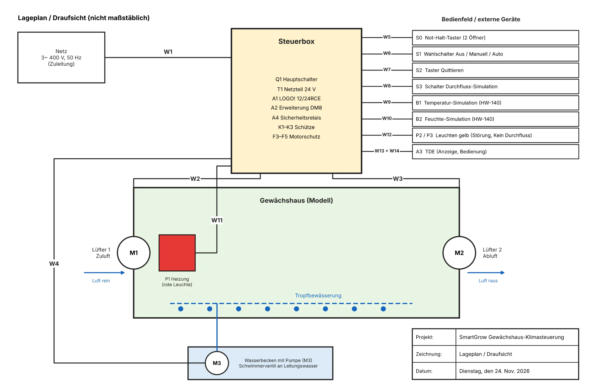

# SmartGrow – Projektmappe (Projekt 2)

Gewächshaus-Klimasteuerung mit Siemens LOGO! · Hugo Collienne · Klasse 4.ET · Schuljahr 2026–2027

Die Word-Version mit Deckblatt und Inhaltsverzeichnis ist [`Projektmappe.docx`](Projektmappe.docx).

# 1 Skizze

Lageplan des Modell-Gewächshauses mit Steuerbox, Gewächshaus, Lüftern, Heizung, Pumpe und Becken.

*Abbildung 1: Lageplan des SmartGrow-Gewächshauses*

# 2 Beschreibung

## 2.1 Gegenstandsbeschreibung

SmartGrow ist das Modell eines Gewächshauses mit automatischer Klimasteuerung und Bewässerung. Die Anlage hält die Temperatur in einem einstellbaren Bereich und gießt die Pflanzen nach der Bodenfeuchte.

Das Modell besteht aus zwei Teilen:

- **Steuerbox:** Hier sitzen Hauptschalter, Netzteil, Steuerung, Sicherheitsrelais, Schütze und Motorschutzschalter. Auf der Außenseite liegen der Not-Halt, der Wahlschalter, der Quittier-Taster, die Leuchten und das Display.

- **Gewächshaus-Modell:** Lüfter 1 bläst Luft hinein (Zuluft), Lüfter 2 saugt Luft heraus (Abluft). Die Heizung wird mit einer roten Leuchte simuliert. Eine Pumpe fördert Wasser aus einem Becken zur Tropfbewässerung. Das Becken ist über ein mechanisches Schwimmerventil an die Wasserleitung angeschlossen und füllt sich selbst nach.

Die Sensoren für Temperatur, Bodenfeuchte und Durchfluss werden im Modell mit Spannungsquellen (HW-140) und einem Schalter simuliert. Echte Sensoren für diese Aufgaben stehen unter Quelle (Kapitel 5).

### Hauptkomponenten

| **BMK**        | **Bauteil**                                            | **Aufgabe**                                  |
|----------------|--------------------------------------------------------|----------------------------------------------|
| **A1**         | Siemens LOGO! 12/24RCE (6ED1052-1MD08-0BA2)            | Steuerung, 8 Eingänge, 4 Relaisausgänge      |
| **A2**         | Erweiterungsmodul LOGO! DM8 (6ED1055-1MB00-0BA2)       | Zwei zusätzliche Ausgänge Q5 und Q6          |
| **A3**         | Display LOGO! TDE (6ED1055-4MH08-0BA1)                 | Anzeige und Bedienung                        |
| **A4**         | Sicherheitsrelais 3SK1111-1AB30                        | Not-Halt, wirkt unabhängig von der LOGO!     |
| **M1, M2**     | Lüftermotor 4IK25GN-UT4 mit Getriebe 4GN50K            | Lüfter 1 (Zuluft) und Lüfter 2 (Abluft)      |
| **M3**         | Pumpenmotor Siemens 1LE1001-0CB22-2AA4                 | Wasserförderung zur Tropfbewässerung         |
| **K1 bis K3**  | Schütz 3RT2015-2BB42, 24 V DC                          | Schalten Lüfter 1, Lüfter 2 und Pumpe        |
| **F3, F4**     | Motorschutzschalter Siemens 3VU1300-1MC00, 0,16–0,24 A | Schutz der Lüftermotoren, Einstellung 0,16 A |
| **F5**         | Motorschutzschalter Moeller PKZM0-1, 0,63–1 A          | Schutz der Pumpe, Einstellung 0,76 A         |
| **T1**         | Netzteil SITOP PSU100L 24 V/10 A                       | Versorgung der Steuerung                     |
| **S0**         | Not-Halt 3SU1801-0NB00-2AC2                            | Sofort-Stopp, 2 Öffner                       |
| **S1, S2, S3** | Wahlschalter, Quittier-Taster, Schalter Durchfluss     | Bedienung und Simulation                     |
| **P1 bis P3**  | Leuchte rot (Heizung), 2 × Leuchte gelb                | Heizung, Störung, Kein Durchfluss            |
| **B1, B2**     | Spannungsquelle HW-140                                 | Simulation von Temperatur und Bodenfeuchte   |

Die vollständige Stückliste mit allen Bauteilen entsteht im EPLAN-Projekt.

## 2.2 Funktionsbeschreibung

Die Anlage regelt Temperatur und Bewässerung des Modell-Gewächshauses. Sie wird von einer Siemens LOGO! 12/24RCE mit Erweiterungsmodul DM8 und TDE-Display gesteuert.

### Betriebsarten

Die Betriebsart wird mit einem Wahlschalter mit drei Stellungen gewählt.

- **Aus:** Alle Ausgänge sind aus.

- **Manuell:** Lüfter 1, Lüfter 2 und Pumpe werden einzeln über die TDE bedient. Die Verriegelung bleibt aktiv, die Heizung darf nur bei laufendem Lüfter 1 leuchten.

- **Auto:** Die Anlage regelt selbst.

### Temperaturregelung (Auto)

Das Temperatursignal wird mit einem HW-140 simuliert (0,5–10 V entsprechen −10 bis +50 °C). Der Sollwert ist 22 °C, die Totzone ±2 K. Die Totzone von 4 K verhindert, dass Relais und Motoren ständig ein- und ausschalten, wenn die Temperatur um den Sollwert schwankt.

| **Zustand** | **Temperatur** | **Spannung (V)** | **Lüfter 1 (Zuluft)** | **Lüfter 2 (Abluft)** | **Heizung (rote Leuchte)** |
|-------------|----------------|------------------|-----------------------|-----------------------|----------------------------|
| Zu kalt     | unter 20 °C    | unter 5,25       | an                    | aus                   | an                         |
| Sollbereich | 20–24 °C       | 5,25–5,88        | aus                   | aus                   | aus                        |
| Zu warm     | über 24 °C     | über 5,88        | an                    | an                    | aus                        |

Die Heizung leuchtet nur, wenn Lüfter 1 läuft. Heizen und Kühlen gleichzeitig ist ausgeschlossen.

### Temperatursignal und Live Zero

Das Signal beginnt bewusst nicht bei 0 V, sondern bei 0,5 V für −10 °C. Es endet bei 10 V für +50 °C. Misst die LOGO! fast 0 V, kann das keine gültige Temperatur sein: Die Leitung ist unterbrochen oder der Sensor ist ausgefallen. Dieses Prinzip heißt Live Zero und wird in der Industrie zum Beispiel mit 4–20 mA statt 0–20 mA verwendet. Der HW-140 liefert mindestens 0,5 V und eignet sich deshalb gut für dieses Prinzip.

1 °C entspricht 0,158 V, denn der Messbereich von 60 °C verteilt sich auf 9,5 V.

**U = 0,5 V + (T + 10 °C) · 0,1583 V/°C**

Umgekehrt gilt: T = (U − 0,5 V) × 6,316 °C/V − 10 °C.

| **Temperatur (°C)** | **Spannung am HW-140 (V)** |
|---------------------|----------------------------|
| −10                 | 0,50                       |
| 0                   | 2,08                       |
| 20                  | 5,25                       |
| 22                  | 5,57                       |
| 24                  | 5,88                       |
| 50                  | 10,00                      |

### Bewässerung (Auto)

Die Bodenfeuchte wird mit einem zweiten Spannungssignal simuliert (0,5–10 V entsprechen 0–100 %). Unter 40 % \[Vorschlag\] schaltet die Pumpe ein, bis 60 % \[Vorschlag\] erreicht sind. Danach gilt eine Sperrzeit \[Vorschlag: 30 s\], damit nicht sofort wieder gegossen wird.

### Überwachung und Störungen

- Läuft die Pumpe länger als \[Vorschlag: 3 s\] ohne Durchfluss-Signal, schaltet sie ab, die gelbe Leuchte 2 („Kein Durchfluss“) leuchtet und die TDE zeigt eine Meldung. Der Durchfluss wird mit einem Schalter simuliert.

- Fällt ein Analogsignal unter 0,3 V (Fühlerbruch, rechnerisch etwa −11,3 °C, also außerhalb des Messbereichs) oder löst ein Motorschutzschalter aus, gehen alle Ausgänge aus. Die gelbe Leuchte 1 („Störung“) leuchtet und die TDE zeigt eine Störmeldung.

- Jede Störung wird mit dem Quittier-Taster bestätigt, erst danach ist ein Neustart möglich.

Intern rechnet die LOGO! den Bereich 0–10 V als 0–1000 (im LOGO!-Handbuch zu prüfen). Dann entspricht die Schwelle 0,3 V dem Wert 30.

### Not-Halt

Der Not-Halt-Taster (3SU1801-0NB00-2AC2, 2 Öffner, zweikanalig) liegt am Sicherheitsrelais. Es nimmt die Spannung von den Ausgängen weg, unabhängig vom LOGO!-Programm. Die LOGO! erhält nur die Rückmeldung am Eingang I4 und zeigt auf der TDE mit rotem Hintergrund „ALARM!“. Nach dem Entriegeln ist ein Quittieren nötig.

### Anzeigen

Die TDE zeigt Temperatur, Sollwert, Bodenfeuchte, Betriebsart und Meldungen.

# 3 Zeitplan

Der Zeitplan folgt der Vorlage der Schule. Die Kalenderwochen und Abgabetermine werden eingetragen, sobald sie feststehen.

| **Kalenderwoche (KW)**                | **KW** | **KW** | **KW** | **KW** | **KW** | **KW** | **KW** | **KW** | **KW** | **KW** | **KW** | **KW** | **KW** |
|---------------------------------------|--------|--------|--------|--------|--------|--------|--------|--------|--------|--------|--------|--------|--------|
| **Analyse & Definition**              |        |        |        |        |        |        |        |        |        |        |        |        |        |
| \- Beschreibung                       |        |        |        |        |        |        |        |        |        |        |        |        |        |
| \- Definition Leistung                |        |        |        |        |        |        |        |        |        |        |        |        |        |
| \- Skizze                             |        |        |        |        |        |        |        |        |        |        |        |        |        |
| \- Zeitplan                           |        |        |        |        |        |        |        |        |        |        |        |        |        |
| **EPLAN**                             |        |        |        |        |        |        |        |        |        |        |        |        |        |
| \- Stromlaufplan                      |        |        |        |        |        |        |        |        |        |        |        |        |        |
| \- Klemmenplan                        |        |        |        |        |        |        |        |        |        |        |        |        |        |
| \- Stückliste                         |        |        |        |        |        |        |        |        |        |        |        |        |        |
| \- Montageplatte                      |        |        |        |        |        |        |        |        |        |        |        |        |        |
| **Umsetzung**                         |        |        |        |        |        |        |        |        |        |        |        |        |        |
| \- Aufbau                             |        |        |        |        |        |        |        |        |        |        |        |        |        |
| \- Inbetriebnahme & evtl. Fehlersuche |        |        |        |        |        |        |        |        |        |        |        |        |        |
| **LOGO!**                             |        |        |        |        |        |        |        |        |        |        |        |        |        |
| \- Dokumentation                      |        |        |        |        |        |        |        |        |        |        |        |        |        |
| \- Programm                           |        |        |        |        |        |        |        |        |        |        |        |        |        |

**Legende**

will ich fertig sein

muss ich fertig sein

# 4 Definition

Definition der leistungsrelevanten mechanischen Angaben. Alle Motoren sind Drehstrommotoren für 400 V in Sternschaltung. Die Werte stammen von den Typenschildern.

| **Angabe**                            | **Lüftermotor M1, M2 (2 Stück)**     | **Pumpenmotor M3**         |
|---------------------------------------|--------------------------------------|----------------------------|
| **Typ**                               | Oriental Motor 4IK25GN-UT4           | Siemens 1LE1001-0CB22-2AA4 |
| **Aufgabe**                           | Lüfter 1 (Zuluft), Lüfter 2 (Abluft) | Pumpe zur Tropfbewässerung |
| **Spannung, Schaltung**               | 400 V, Stern, 3~                     | 400 V, Stern, 3~           |
| **Nennstrom**                         | 0,12 A                               | 0,76 A                     |
| **Nennleistung P**                    | 25 W                                 | 0,25 kW                    |
| **Drehzahl Motor n**                  | 1300 U/min                           | 1395 U/min                 |
| **Getriebe**                          | 4GN50K, Untersetzung 50:1            | kein Getriebe              |
| **Drehzahl am Lüfter**                | 26 U/min (1300 : 50)                 | 1395 U/min                 |
| **Nennmoment am Motor M (berechnet)** | 0,18 Nm                              | 1,71 Nm                    |
| **Motorschutzschalter**               | 3VU1300-1MC00, 0,16 A                | PKZM0-1, 0,76 A            |

Das Nennmoment wird aus Leistung und Drehzahl berechnet:

**M = P / (2π · n / 60)**

- Lüfter: M = 25 W / (2π · 1300 / 60 s) = 0,18 Nm

- Pumpe: M = 250 W / (2π · 1395 / 60 s) = 1,71 Nm

Die gedruckten Lüfter drehen sich langsam (26 U/min), die Lüftermotoren sind deshalb kaum belastet. Zusammen haben die drei Motoren eine Nennleistung von 300 W (2 × 25 W + 250 W).

# 5 Quelle

Im Modell werden die Sensoren mit dem HW-140 und einem Schalter ersetzt. In einer echten Anlage kämen diese Sensoren zum Einsatz. Die Beispiele zeigen, dass die Signale (0–10 V, potentialfreier Kontakt) zur Steuerung passen.

| **Messgröße**    | **Echter Sensor (Beispiel)**                                       | **Ausgangssignal**         | **Im Modell ersetzt durch** |
|------------------|--------------------------------------------------------------------|----------------------------|-----------------------------|
| **Temperatur**   | RS PRO Temperatursensor −20 bis +50 °C, Wandmontage                | 0–10 V DC                  | HW-140 (B1), 0,5–10 V       |
| **Temperatur**   | S+S Regeltechnik THERMASGARD RTM 1, 0 bis +50 °C                   | 0–10 V oder 4–20 mA        | HW-140 (B1), 0,5–10 V       |
| **Bodenfeuchte** | Truebner SMT100, Bodenfeuchte 0–100 % VWC, 12–24 V DC              | 0–10 V                     | HW-140 (B2), 0,5–10 V       |
| **Durchfluss**   | Siemens Strömungswächter QVE1900                                   | Schaltkontakt              | Schalter S3                 |
| **Durchfluss**   | S+S Regeltechnik RHEASREG SW, mechanischer Paddel-Strömungswächter | potentialfreier Umschalter | Schalter S3                 |

### Links

1.  [<u>RS PRO Temperatursensor (Datenblatt)</u>](https://docs.rs-online.com/fa19/A700000007130817.pdf)

2.  [<u>S+S Regeltechnik THERMASGARD RTM 1 (Datenblatt)</u>](https://spluss.de/cdn/shop/files/RTM-1__DE.pdf)

3.  [<u>Truebner SMT100, analog 0–10 V (Shop)</u>](https://dvs-beregnung.de/truebner-smt100-analog-0-10-v-bodenfeuchte-und-temperatursensor)

4.  [<u>Siemens QVE1900 Durchflussschalter (RS Components)</u>](https://de.rs-online.com/web/p/durchflusssensoren/2878747)

5.  [<u>S+S Regeltechnik RHEASREG SW Strömungswächter (Datenblatt)</u>](https://docs.rs-online.com/e17a/A700000015418388.pdf)

6.  [<u>HW-140 DC-DC Buck-Boost-Wandler (Datenblatt)</u>](https://cdn.shopify.com/s/files/1/1509/1638/files/HW-140_Datasheet.pdf)

7.  [<u>HW-140 bei AZ-Delivery</u>](https://www.az-delivery.de/en/products/hw-140-buck-boost-converter-mit-anzeige)

Der HW-140 wandelt eine Eingangsspannung von 5,5–30 V in eine einstellbare Ausgangsspannung von 0,5–30 V bei maximal 3 A. Die kleinste Ausgangsspannung von 0,5 V passt zum Live-Zero-Signal, das im Modell bei 0,5 V beginnt.
