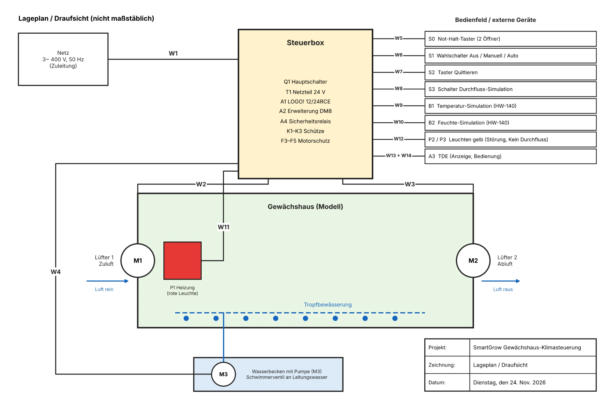
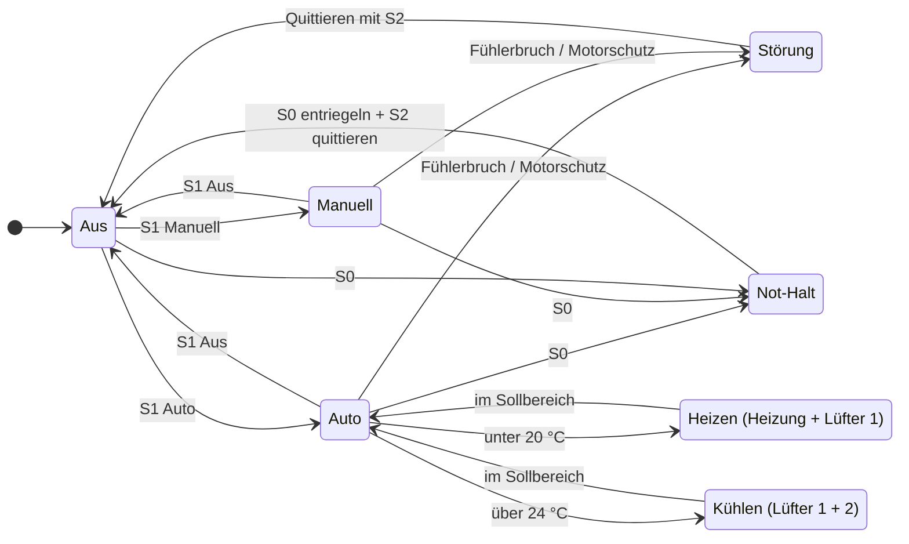

# 🌱 SmartGrow

**Gewächshaus-Klimasteuerung mit Siemens LOGO!**

*Projekt 2 · Planung & Dokumentation*

---

## 📑 Inhalt

- [Über das Projekt](#-über-das-projekt)
- [Funktionsweise](#️-funktionsweise)
- [Ablaufdiagramm](#-ablaufdiagramm)
- [Sicherheit & Verriegelung](#-sicherheit--verriegelung)
- [Temperatursignal: Live Zero](#-temperatursignal-live-zero)
- [Komponenten](#-komponenten)
- [Ein- und Ausgänge](#-ein--und-ausgänge)
- [Projektdateien](#-projektdateien)
- [Autor](#-autor)

---

## 💡 Über das Projekt

**SmartGrow** ist eine Klimasteuerung für ein Gewächshaus. Sie hält die Temperatur in einem einstellbaren Bereich (**Sollwert 22 °C ± 2 K**) und bewässert die Pflanzen nach der **Bodenfeuchte**. Zum Kühlen arbeiten zwei Lüfter zusammen: Lüfter 1 bläst Luft hinein, Lüfter 2 saugt Luft heraus. Zum Heizen läuft Lüfter 1 mit der **Heizung**, die mit einer roten Leuchte simuliert wird.

Gesteuert wird die gesamte Anlage über eine **Siemens LOGO!** mit Erweiterungsmodul und Bediengerät **TDE**. Die Motoren werden über Siemens-Sirius-Schütze geschaltet und mit Motorschutzschaltern abgesichert. Der Not-Halt wirkt **indirekt** über ein Sicherheitsrelais.

---

## ⚙️ Funktionsweise

### 🔘 Betriebsarten (Wahlschalter S1)

| Stellung | Verhalten |
|:-:|---|
| ⏹️ **Aus** | Alle Verbraucher sind aus. Die TDE zeigt Temperatur, Bodenfeuchte und Sollwert. |
| 🖐️ **Manuell** | Lüfter 1 (F1), Lüfter 2 (F2), Heizung (F3) und Pumpe (F4) werden einzeln an der TDE geschaltet. Verriegelungen bleiben aktiv. |
| 🤖 **Auto** | Die LOGO! regelt Temperatur und Bewässerung selbstständig. |

### 🌡️ Temperaturregelung (Auto)

| Temperatur | Lüfter 1 (Zuluft) | Lüfter 2 (Abluft) | Heizung (rote Leuchte) |
|---|:-:|:-:|:-:|
| 🔵 **unter 20 °C** (zu kalt) | ✅ an | ❌ aus | ✅ an |
| 🟢 **20 °C bis 24 °C** (Sollbereich) | ❌ aus | ❌ aus | ❌ aus |
| 🔴 **über 24 °C** (zu warm) | ✅ an | ✅ an | ❌ aus |

Der Sollwert (Standard 22 °C) wird an der TDE eingestellt. Der Sollbereich liegt 2 °C darunter und darüber.

### 💧 Bewässerung

| # | Ereignis | Reaktion |
|:-:|---|---|
| 1 | Bodenfeuchte **unter 40 %** | Pumpe schaltet ein |
| 2 | Bodenfeuchte erreicht **60 %** | Pumpe schaltet aus |
| 3 | Pumpe ist aus | **30 s Sperrzeit**, dann ist ein neuer Start möglich |
| 4 | **3 s** nach Pumpenstart kein Durchfluss | Pumpe aus, gelbe Leuchte P3, Meldung „Kein Durchfluss“ |
| 5 | Meldung wird mit **S2** quittiert | Pumpe ist wieder freigegeben |

Das Wasserbecken ist über ein **mechanisches Schwimmerventil** an die Wasserleitung angeschlossen und füllt sich selbst nach.

### ⚠️ Störungen

| Ursache | Erkennung | Reaktion |
|---|---|---|
| Fühlerbruch (Temperatur) | Spannung **unter 0,3 V** | Alles aus, gelbe Leuchte P2, Meldung auf der TDE |
| Motorschutzschalter ausgelöst | Sammelmeldung an Eingang I5 | Alles aus, gelbe Leuchte P2, Meldung auf der TDE |

Nach dem Beheben der Ursache muss die Störung mit **S2** quittiert werden. In **Auto** läuft die Regelung dann von selbst weiter, in **Manuell** bleiben alle Verbraucher aus, bis sie an der TDE wieder eingeschaltet werden.

---

## 🔄 Ablaufdiagramm

---

## 🛑 Sicherheit & Verriegelung

> [!IMPORTANT]
> **Not-Halt S0:** Der Taster hat zwei Öffner und wirkt auf das **Sicherheitsrelais Siemens 3SK1**. Dessen Freigabekontakte trennen die +24 V der Ausgänge für Lüfter, Heizung und Pumpe. Alles steht sofort still, **unabhängig vom LOGO!-Programm**. Die LOGO! erhält über Eingang **I4** nur eine Rückmeldung (24 V = in Ordnung, 0 V = Not-Halt oder Leitungsbruch) und zeigt auf der TDE „ALARM!!!“. Nach dem Entriegeln von S0 bleibt die Anlage aus, bis mit **S2** quittiert wurde.

- 🔒 **Heizung nur mit Lüfter 1** – schaltet Lüfter 1 aus, schaltet auch die Heizung aus.
- 🔥 **Nie Heizen und Kühlen gleichzeitig.**
- 💦 **Trockenlaufschutz** – ohne Durchfluss schaltet die Pumpe nach 3 s ab.
- 🔌 **Ruhestromprinzip** – ein Leitungsbruch im Not-Halt-Kreis wirkt wie ein ausgelöster Not-Halt.
- 🛡️ **Motorschutzschalter** für beide Lüfter und die Pumpe.

---

## 📈 Temperatursignal: Live Zero

Die Temperatur wird nicht von 0 V an übertragen, sondern von **0,5 V bis 10 V** (−10 °C bis +50 °C). So erkennt die LOGO! einen Leitungsbruch: Fällt die Spannung unter 0,3 V, ist das Signal nicht mehr gültig.

| Temperatur | Spannung |
|:-:|:-:|
| −10 °C | 0,5 V |
| 0 °C | 2,08 V |
| 20 °C | 5,25 V |
| 22 °C | 5,57 V |
| 24 °C | 5,88 V |
| +50 °C | 10 V |

`U = 0,5 V + (T + 10 °C) · 0,1583 V/°C`

Die Bodenfeuchte wird mit demselben Prinzip übertragen: **0,5 V bis 10 V entsprechen 0 % bis 100 %**. Beide Signale werden mit je einem DC-DC-Wandler **HW-140** simuliert.

---

## 🧰 Komponenten

| Bauteil | Typ / Hersteller | Technische Daten |
|---|---|---|
| Steuerung A1 | Siemens LOGO! 12/24RCE `6ED1052-1MD08-0BA2` | 12/24 V DC · 8 Eingänge · 4 Relaisausgänge |
| Erweiterung A2 | Siemens LOGO! DM8 12/24R `6ED1055-1MB00-0BA2` | 4 Eingänge · 4 Relaisausgänge |
| Bediengerät A3 | Siemens LOGO! TDE `6ED1055-4MH08-0BA1` | Anzeige und Bedienung über Ethernet |
| Sicherheitsrelais A4 | Siemens 3SK1111-1AB30 | Zweikanaliger Not-Halt |
| Lüfter M1, M2 | Oriental Motor 4IK25GN-UT4 + Getriebe 4GN50K | 400 V · 0,12 A · 25 W · ca. 26 U/min |
| Pumpe M3 | Siemens 1LE1001-0CB22-2AA4 | 400 V · 0,76 A |
| Schütze K1–K3 | Siemens Sirius 3RT2015-2BB42 | Steuerspannung 24 V DC · 3 kW (AC-3) |
| Motorschutz F3, F4 | Siemens Sirius 3RV2011-0AA15 | eingestellt auf 0,12 A |
| Motorschutz F5 | Siemens Sirius 3RV2011-0HA15 | eingestellt auf 0,76 A |
| Netzteil T1 | Siemens SITOP PSU100L 6EP1334-1LB00 | 230 V AC auf 24 V DC · 10 A |
| Hauptschalter Q1 | Siemens 3LD3054-0TL53 | 3-polig · 400 V |
| Leitungsschutz F1, F2 | Siemens 5SY6202-7 / 5SY6102-7 | C · 2 A |
| Not-Halt S0 | Siemens 3SU1801-0NB00-2AC2 | 2 Öffner · IP66 · Drehentriegelung |
| Wahlschalter S1 | Aus / Manuell / Auto | 3 Stellungen |
| Taster S2 | Siemens 3SU1 (blau) | Quittieren |
| Leuchten P2, P3 | Eaton SL7-L24-Y | 2 × gelb · 24 V · 54 mA |
| Heizung P1 | Leuchtmelder rot | 24 V · simuliert die Heizung |
| Simulation B1, B2 | DC-DC-Wandler HW-140 | 5,5–30 V Eingang · 0,5–30 V Ausgang · 3 A |

> [!NOTE]
> Einzelne Typen und Bereiche werden noch im Katalog geprüft. Die endgültige Liste steht in der `Projektmappe.docx`.

---

## 🔌 Ein- und Ausgänge

| Eingang | Funktion | Ausgang | Funktion |
|:-:|---|:-:|---|
| **I1** | Wahlschalter S1: Manuell | **Q1** | Lüfter 1 (K1) |
| **I2** | Wahlschalter S1: Auto | **Q2** | Lüfter 2 (K2) |
| **I3** | Taster S2: Quittieren | **Q3** | Heizung (rote Leuchte P1) |
| **I4** | Sicherheitsrelais: Not-Halt in Ordnung | **Q4** | Pumpe (K3) |
| **I5** | Sammelstörung Motorschutz | **Q5** | Leuchte P2 gelb: Störung |
| **I6** | Durchflussschalter S3 | **Q6** | Leuchte P3 gelb: Kein Durchfluss |
| **I7** | Temperatur B1 (0,5–10 V) | | |
| **I8** | Bodenfeuchte B2 (0,5–10 V) | | |

---

## 📁 Projektdateien

| Datei | Inhalt |
|---|---|
| 📘 [`Projektmappe.docx`](Projektmappe.docx) | Projektmappe mit Skizze, Beschreibung, Zeitplan und Bauteilliste |
| 🖼️ [`Skizze/`](Skizze) | Lageplan des Gewächshauses |

> [!NOTE]
> Schaltplan (EPLAN), LOGO!-Programm und Zeitplan folgen, sobald sie fertig sind.

---

## 👤 Autor

**Hugo Collienne** · Klasse 4.ET · Periode 2
Bischöfliche Schule St. Vith – Technisches Institut ([bsti.be](https://www.bsti.be))
