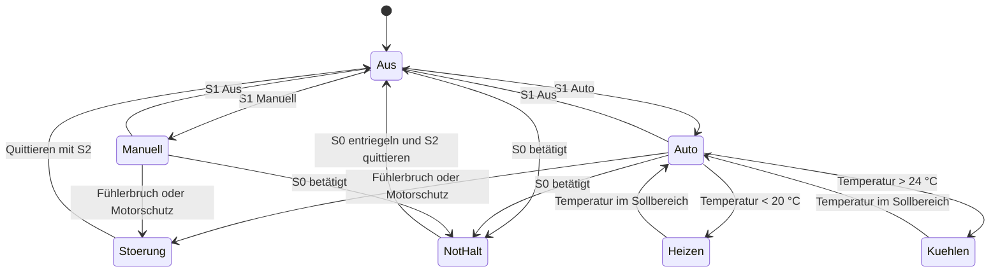

# SmartGrow – Gewächshaus-Klimasteuerung

**Projekt 2 · 4.ET · Bischöfliche Schule St. Vith (BSTI)**
Planung und Dokumentation einer Gewächshaus-Klimasteuerung mit Siemens LOGO! 12/24RCE.

## Idee

SmartGrow hält die Temperatur im Gewächshaus in einem einstellbaren Bereich (Sollwert 22 °C ± 2 K) und bewässert nach der Bodenfeuchte. Zwei Lüfter kühlen, eine Heizung (rote Leuchte) heizt, eine Pumpe bewässert. Bedient wird mit einem Wahlschalter (Aus / Manuell / Auto) und der LOGO! TDE.

## Funktionen

| Funktion | Kurzbeschreibung |
|---|---|
| Automatik | Unter 20 °C: Heizung + Lüfter 1. Über 24 °C: Lüfter 1 + Lüfter 2. Dazwischen alles aus. |
| Manuell | Alle Verbraucher einzeln über die TDE (F1–F4), Verriegelungen bleiben aktiv. |
| Bewässerung | Pumpe ein unter 40 % Bodenfeuchte, aus bei 60 %, danach 30 s Sperrzeit. |
| Durchflussüberwachung | Kein Durchfluss 3 s nach Pumpenstart: Pumpe aus, Meldung, Quittieren mit S2. |
| Fühlerbruch | Temperatursignal 0,5–10 V (Live Zero). Unter 0,3 V: Störung, alles aus. |
| Not-Halt | Indirekt über Sicherheitsrelais Siemens 3SK1, Rückmeldung an die LOGO!. |

## Hardware (Auswahl)

| BMK | Bauteil |
|---|---|
| A1 | Siemens LOGO! 12/24RCE 6ED1052-1MD08-0BA2 |
| A2 | Siemens LOGO! DM8 12/24R 6ED1055-1MB00-0BA2 |
| A3 | Siemens LOGO! TDE 6ED1055-4MH08-0BA1 |
| A4 | Sicherheitsrelais Siemens 3SK1111-1AB30 |
| M1, M2 | Oriental Motor 4IK25GN-UT4 mit Getriebe 4GN50K (Lüfter) |
| M3 | Siemens 1LE1001-0CB22-2AA4 (Pumpe) |
| B1, B2 | DC-DC-Wandler HW-140 (Simulation Temperatur und Bodenfeuchte) |

Die vollständige Bauteilliste, die Kabelliste und die Ein- und Ausgänge stehen in der `Projektmappe.docx`.

## Dateien

- `Projektmappe.docx` – Deckblatt, Skizze, Beschreibung, Zeitplan, Definition, Quellen
- Eplan-Projekt, LOGO!-Programm und Zeitplan folgen.

## Status

In Arbeit (Planungsphase).
